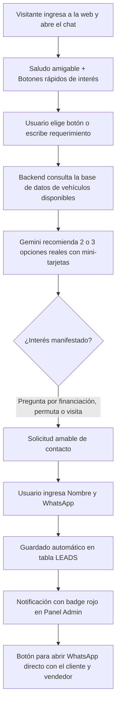

# 🤖 Plan de Integración: Chatbot Asesor IA con Gemini

**Proyecto:** Sistema de Gestión Automotriz - Automotores Marcos  
**Fecha:** Octubre 2026  
**Tecnología IA recomendada:** Google Gemini 1.5 / 2.0 Flash (Free Tier vía Google AI Studio)

---

## 1. Objetivo del Proyecto

Transformar la Landing Page de **Automotores Marcos** en un canal de venta activo 24/7 mediante un **Asesor Virtual Inteligente**.  
El objetivo principal no es solo responder dudas genéricas, sino:
1. **Recomendar vehículos reales** en base a las necesidades, preferencias y presupuesto del cliente.
2. **Cualificar al interesado** e identificar su intención real de compra (permuta, financiación, compra de contado).
3. **Capturar su número de WhatsApp/teléfono y nombre**, derivándolo automáticamente al panel de administración y al vendedor.

---

## 2. Estrategia de Experiencia de Usuario (Enfoque Híbrido)

Para maximizar la conversión en dispositivos móviles y de escritorio, se adoptará una experiencia **híbrida (Botones rápidos + Lenguaje natural)**:

### A. Botones de Acción Rápida (Quick Replies)
Permiten al usuario interactuar en un solo clic sin necesidad de escribir:
* 🚗 *"Ver autos familiares / SUVs"*
* 💰 *"Filtrar por presupuesto"*
* 🔥 *"Ver ofertas destacadas"*
* 🏍️ *"Motos disponibles"*
* 💳 *"Consultar por Financiación / Permutas"*

### B. Comprensión en Lenguaje Natural (Gemini)
Si el usuario escribe consultas específicas o complejas (ej.: *"Tengo un Gol 2015 para entregar y busco una chata doble cabina gasolera"*), el modelo entiende el contexto, consulta el inventario y responde con empatía y precisión comercial.

### C. Mini-Tarjetas de Vehículos Interactivas
El bot no solo responde con texto plano:
* Muestra tarjetas dentro del chat con: foto principal, marca, modelo, año, kilometraje y precio/oferta.
* Botón directo *"Me interesa este"* que inicia el proceso de contacto.

---

## 3. Flujo de Cualificación y Captura de Leads



### Reglas de Conversión
* **No solicitar datos de golpe:** Se evita pedir el teléfono en el primer mensaje para no generar rechazo.
* **Momento oportuno:** Se solicita el WhatsApp únicamente cuando el cliente demostró interés en un auto, consultó financiación o pidió cotizar su usado.
* **Mensaje de derivación:**  
  > *"¡Excelente elección! Para armarte la propuesta a medida o coordinar para que veas el auto en Morteros, ¿a qué número de WhatsApp te contactamos y cómo te llamás?"*

---

## 4. Costos y Factibilidad (Google Gemini Free Tier)

El uso de **Google Gemini API** mediante **Google AI Studio** cuenta con un nivel gratuito permanente:

| Característica | Límite Gratuito | Requerimiento de la Concesionaria |
| :--- | :--- | :--- |
| **Consultas por minuto (RPM)** | 15 RPM | Sobrado (un usuario genera ~1-2 por min) |
| **Consultas por día (RPD)** | 1.500 RPD | Muy por encima de las necesidades (se esperan decenas por día) |
| **Costo mensual** | **$0.00 USD** | Totalmente gratuito |
| **Mantenimiento** | Cero | Clave API gratuita de Google |

---

## 5. Arquitectura Técnica sobre el Sistema Actual

Aprovecha al 100% la infraestructura existente en el repositorio:

```
┌─────────────────────────────────────────────────────────────────┐
│ 1. LANDING PAGE (landin/)                                       │
│    - Botón flotante "Asesor Virtual" al lado de WhatsApp        │
│    - Modal/Widget de chat moderno y responsive                  │
│    - Script js/chat.js para gestión de estados y mensajes       │
└────────────────────────────────┬────────────────────────────────┘
                                 │ POST /api/public/chat
                                 ▼
┌─────────────────────────────────────────────────────────────────┐
│ 2. SERVIDOR BACKEND (server/index.js)                           │
│    - Nuevo endpoint: POST /api/public/chat                      │
│    - Conexión a SQLite: consulta autos disponibles y fotos      │
│    - Llamada a Gemini API con System Prompt personalizado       │
│    - Detección de leads -> Inserción directa en tabla `leads`   │
└────────────────────────────────┬────────────────────────────────┘
                                 │
                                 ▼
┌─────────────────────────────────────────────────────────────────┐
│ 3. PANEL ADMINISTRATIVO (client/ - React)                       │
│    - Pestaña "Consultas": recibe los leads del chat en vivo     │
│    - Badge rojo con contador de nuevas consultas                │
│    - Botón de 1 clic para iniciar chat de WhatsApp con el lead  │
└─────────────────────────────────────────────────────────────────┘
```

---

## 6. Etapas de Implementación

### Fase 1: Backend y Conexión con IA
- [ ] Instalar la librería oficial de Gemini (`@google/genai` o `@google/generative-ai`) en `server/`.
- [ ] Configurar la variable de entorno `GEMINI_API_KEY` en `server/.env` y en Railway.
- [ ] Diseñar el System Prompt con la identidad de **Automotores Marcos** (ubicación en Morteros Córdoba, políticas de usados/0km, financiación).
- [ ] Crear el endpoint `POST /api/public/chat` que:
  - Inyecte el stock actualizado desde `database.sqlite` (evitando alucinaciones de autos inexistentes).
  - Devuelva la respuesta del bot y los IDs de los vehículos sugeridos.
  - Si el usuario suministra nombre y teléfono, inserte automáticamente el registro en la tabla `leads`.

### Fase 2: Interfaz del Chatbot en la Landing Page
- [ ] Crear el componente visual del widget de chat en `landin/index.html` (botón flotante interactivo, ventana de conversación, animaciones de escritura).
- [ ] Crear `landin/js/chat.js` para:
  - Controlar la apertura/cierre de la ventana.
  - Enviar y recibir mensajes mediante el endpoint `/api/public/chat`.
  - Renderizar botones de respuesta rápida y tarjetas de vehículos con foto.
  - Persistir el historial en `sessionStorage` para que la conversación no se pierda al recargar la página.

### Fase 3: Integración de Leads y Notificaciones
- [ ] Validar que cuando el bot capture un teléfono, se registre en la tabla `leads` con estado `'Nuevo'` y mensaje indicando el auto de interés.
- [ ] Comprobar que en el panel React (`client/`) la consulta aparezca en tiempo real con su respectivo botón de WhatsApp listo para responder.

### Fase 4: Pruebas y Despliegue
- [ ] Pruebas de estrés y casos borde (preguntas fuera de contexto, autos sin stock, números de teléfono mal formateados).
- [ ] Validación de límites del Free Tier de Gemini.
- [ ] Despliegue en producción en Railway.

---

## 7. Medidas de Seguridad y Buenas Prácticas
1. **Protección de la API Key:** La clave nunca se expondrá en el frontend; todas las llamadas a Gemini se procesan de forma segura desde el backend en Node.js.
2. **Prevención de Alucinaciones:** El agente únicamente recomendará vehículos existentes en `database.sqlite` con estado `Disponible` o `Muy Visto`.
3. **Control de Abuso / Rate Limit:** Evitar consumo excesivo limitando la cantidad de mensajes consecutivos por sesión IP.
